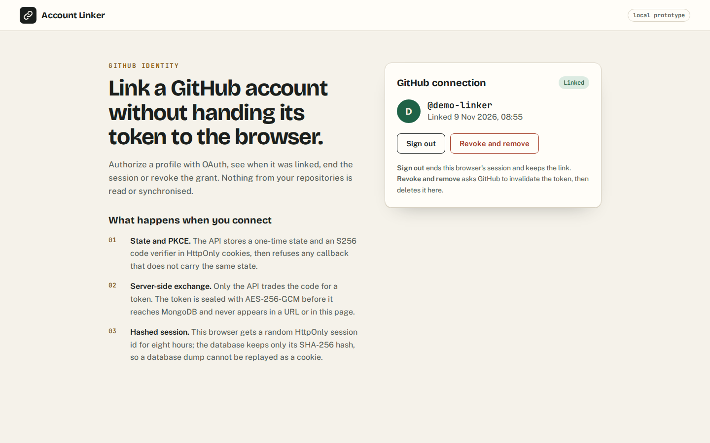
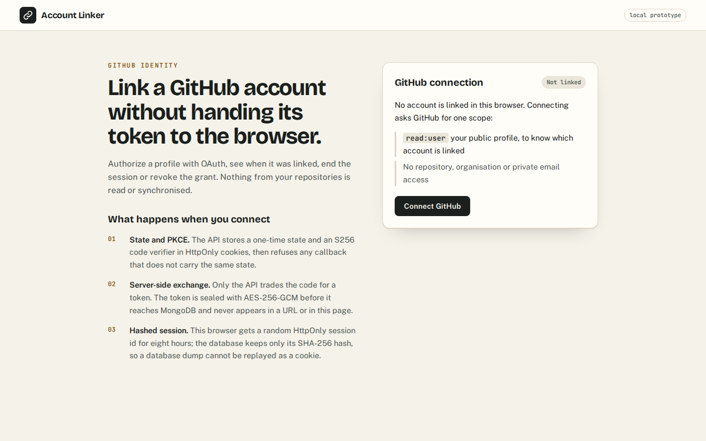
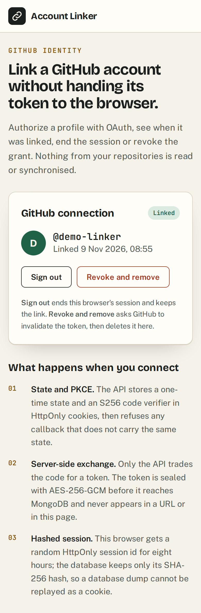
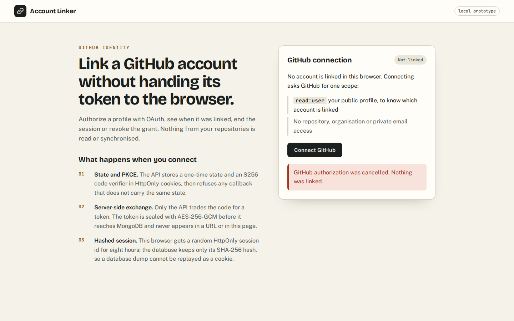
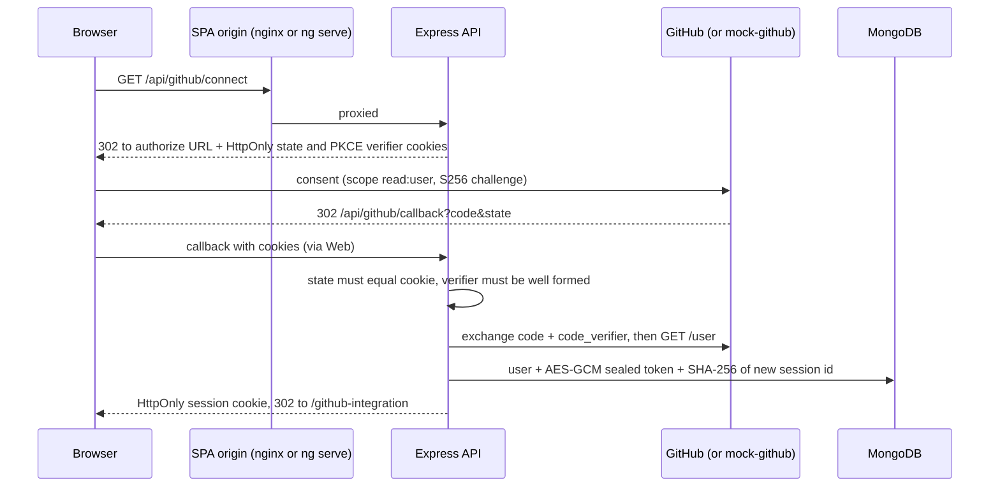

# GitHub account linker

An Angular 22 single-page app and an Express 5 / MongoDB API that link a GitHub account through OAuth, show which login is linked and since when, end the session, or revoke the grant. It shows the OAuth boundary on its own: no repositories are imported or synced, and the only scope requested is `read:user`.

The provider token never leaves the server. The browser holds only an HttpOnly session cookie, and the database keeps only a hash of that cookie plus an AES-256-GCM sealed copy of the token.



| Not linked | Linked (mobile) | Consent cancelled |
| --- | --- | --- |
|  |  |  |

The screenshots were taken against the bundled GitHub mock, signed in as the fictional `demo-linker`.

## How a link is made



The SPA reaches the API at `/api` on its own origin: through nginx in Docker, through `proxy.conf.json` under `ng serve`. The callback and the session cookie are therefore first-party and the API needs no CORS. Any request that changes state (`POST`, `DELETE`) must carry an `Origin` equal to `FRONTEND_URL`. `SameSite=Lax` alone would still let another app on a different localhost port send those requests with the cookie attached.

## Run it with Docker

This needs Docker with Compose v2 and nothing else. The stack is MongoDB 7, a local mock of GitHub's OAuth endpoints, the API, and the SPA behind nginx.

```sh
printf 'TOKEN_ENCRYPTION_KEY=%s\n' "$(openssl rand -hex 32)" > .env
docker compose up --build
```

Open http://localhost:4200, press **Connect GitHub** and approve on the mock consent page (port 4010). Pressing **Cancel** there shows the error path. `docker compose down -v` removes everything, including the database volume.

To use a real GitHub OAuth app, register the callback `http://localhost:4200/api/github/callback` and add `GITHUB_CLIENT_ID`, `GITHUB_CLIENT_SECRET` and the three GitHub URLs from [.env.example](.env.example) to `.env`.

## Run it without Docker

You need Node 22.22 or newer (`.nvmrc`) and a MongoDB you can write to.

```sh
cd backend
npm ci
cp .env.example .env   # set DB_URL, TOKEN_ENCRYPTION_KEY and the GitHub app values
npm run dev            # API on 127.0.0.1:3000

cd ../frontend
npm ci
npm start              # SPA on http://localhost:4200, /api proxied to :3000
```

If you have no OAuth app, `node mock-github/server.mjs` starts the mock on port 4010. Point the API at it in `backend/.env`:

```sh
GITHUB_CLIENT_ID=mock-client-id
GITHUB_CLIENT_SECRET=mock-client-secret
GITHUB_AUTHORIZE_URL=http://localhost:4010/login/oauth/authorize
GITHUB_TOKEN_URL=http://localhost:4010/login/oauth/access_token
GITHUB_API_BASE_URL=http://localhost:4010
```

## API

| Route | Behaviour |
| --- | --- |
| `GET /api/github/connect` | Sets 10-minute state and verifier cookies, redirects to the authorize URL |
| `GET /api/github/callback` | Validates state, exchanges the code with the verifier, creates the session. Failures redirect to the UI with `?error=invalid_state`, `access_denied`, `invalid_callback` or `oauth_failed` |
| `GET /api/github/status` | `200` with login and link date for a live session, `401` otherwise |
| `POST /api/github/logout` | Clears the stored session hash and the cookie and keeps the link (`204`) |
| `DELETE /api/github/remove` | Revokes the token at GitHub, then deletes the user and link (`200`), or `502` if GitHub did not confirm |
| `GET /health` | Liveness for the container health check |

These responses were captured from the Compose stack through nginx, with cookie values and PKCE parameters shortened:

```http
GET /api/github/connect

HTTP/1.1 302 Found
Set-Cookie: github_oauth_verifier=<64 hex>; Max-Age=600; Path=/api/github; HttpOnly; SameSite=Lax
Set-Cookie: github_oauth_state=<64 hex>; Max-Age=600; Path=/api/github; HttpOnly; SameSite=Lax
Location: http://localhost:4010/login/oauth/authorize?client_id=demo-client-id&redirect_uri=http%3A%2F%2Flocalhost%3A4200%2Fapi%2Fgithub%2Fcallback&scope=read%3Auser&state=…&code_challenge=…&code_challenge_method=S256
```

```http
GET /api/github/callback?code=…&state=…

HTTP/1.1 302 Found
Set-Cookie: github_oauth_verifier=; Path=/api/github; Expires=Thu, 01 Jan 1970 00:00:00 GMT; HttpOnly; SameSite=Lax
Set-Cookie: github_oauth_state=; Path=/api/github; Expires=Thu, 01 Jan 1970 00:00:00 GMT; HttpOnly; SameSite=Lax
Set-Cookie: github_link_session=<64 hex>; Max-Age=28800; Path=/api/github; HttpOnly; SameSite=Lax
Location: http://localhost:4200/github-integration
```

```http
GET /api/github/status

HTTP/1.1 200 OK
{"isConnected":true,"username":"demo-linker","connectionDate":"2026-11-09T08:55:29.273Z"}
```

```http
DELETE /api/github/remove
Origin: http://localhost:8080

HTTP/1.1 403 Forbidden
{"message":"Request origin is not allowed"}
```

The matching MongoDB user document after sign-in:

```js
{ githubId: '90210001', username: 'demo-linker', accessToken: 'v1.Ud2A_KT…', sessionHash: 'a7589dae…', sessionExpiresAt: ISODate('2026-11-09T16:55:29.269Z') }
```

## Design notes

- **Revocation.** GitHub answers `404` both for a token the user already revoked on github.com and for wrong app credentials. The API checks the token with `GET /user` before it treats a `404` as success. A dead token (`401`) is cleaned up locally. A live one keeps the link and returns `502`, so a misconfigured secret cannot leave a valid grant behind.
- **Sessions.** One session per GitHub user. A new sign-in replaces the previous session, and sign-out invalidates the hash on the server, not just the cookie. Cookies are `Secure` whenever `OAUTH_CALLBACK_URL` uses https.
- **Token storage.** Tokens are sealed with `TOKEN_ENCRYPTION_KEY` as `v1.<iv>.<ciphertext>.<tag>`. Rows written by older versions as `Bearer …` plain text can still be read for revocation and are re-sealed at the next sign-in.
- **Error handling.** OAuth and provider failures are logged as fixed messages. Axios errors are never serialised, because they can carry the client secret or an Authorization header.

## Tests

```sh
cd backend && npm test && npm run lint     # 21 node:test cases: controllers, cipher, HTTP routing
DB_URL=mongodb://localhost:27017/linker_e2e npm run test:e2e   # 7 end-to-end cases, real MongoDB + mock GitHub
cd frontend && npm test && npm run lint    # 12 Vitest specs, angular-eslint with template a11y rules
```

The end-to-end suite drops the database you point it at, so give it a disposable one. It covers a full sign-in, a swapped state cookie, a wrong PKCE verifier, a cancelled consent, replaying a cookie after sign-out, removal from a foreign origin, and removal after the grant was revoked on the provider.

## Limits

This is a local prototype. It has no rate limiting, no key rotation for `TOKEN_ENCRYPTION_KEY`, no audit log, and one session per user. Deploying it under a different host means changing `OAUTH_CALLBACK_URL`, `FRONTEND_URL` and the nginx proxy together. An earlier version committed a credential-like value in `backend/.env.example`. Whether it was ever valid is unknown, and the owner of that OAuth app should revoke it if it was.

## License

[MIT](LICENSE)
