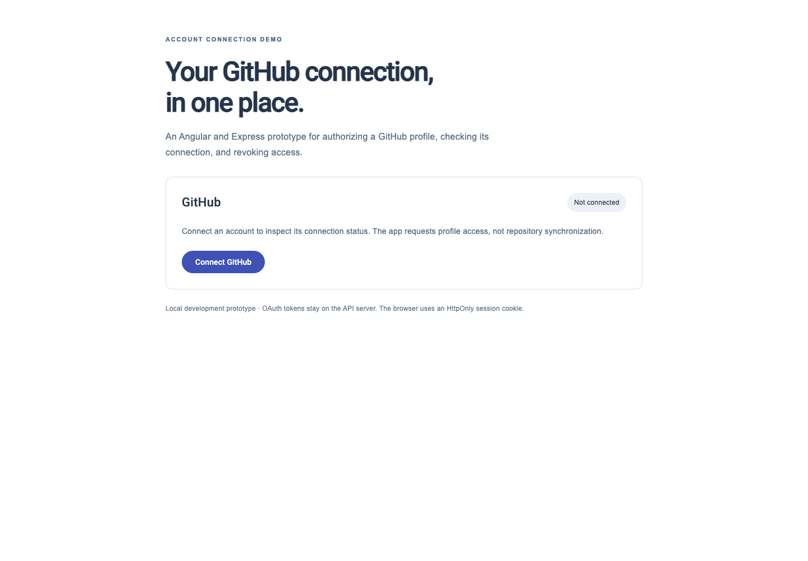

# GitHub account linker

A local Angular/Express/MongoDB prototype for authorizing a GitHub profile, displaying its connection date, and revoking access. It demonstrates an OAuth boundary rather than repository synchronization: it does not import code, run a sync job, or track a “last synced” timestamp.



## A token stays on the server

```mermaid
sequenceDiagram
  participant Browser
  participant API as Local Express API
  participant GitHub
  participant DB as MongoDB
  Browser->>API: Connect
  API-->>Browser: State + PKCE cookies and authorization redirect
  Browser->>GitHub: Authorize profile access
  GitHub-->>API: Code and state
  API->>API: Validate state and PKCE verifier
  API->>GitHub: Exchange code, then read profile
  API->>DB: Store provider token and hashed app session
  API-->>Browser: HttpOnly session cookie; redirect without token
  Browser->>API: Connection status with cookie
```

The previous implementation returned a provider access token in the redirect query and stored it in browser localStorage. This version removes both paths. It validates an unpredictable state value, uses S256 PKCE, requests `read:user` instead of broad repository access, and creates a separate eight-hour application session. The browser's session nonce is HttpOnly; MongoDB stores its hash and expiry. Old browser access-token storage is discarded when the page opens.

These choices follow GitHub's [OAuth authorization guidance](https://docs.github.com/en/apps/oauth-apps/building-oauth-apps/authorizing-oauth-apps) and [scope definitions](https://docs.github.com/en/apps/oauth-apps/building-oauth-apps/scopes-for-oauth-apps). A new local session is required after this update; old provider-token Authorization headers are no longer accepted.

## Run the two applications

Use an isolated Node.js environment compatible with Angular 18 and the supplied lockfiles, plus a local MongoDB instance. Both services need their own dependency installation.

```sh
cd backend
npm ci --ignore-scripts
cp .env.example .env
# Configure a GitHub OAuth app you control and a local MongoDB database.
npm run dev
```

The local callback is `http://localhost:3000/api/github/callback`; configure that exact callback in your OAuth app and use `SERVER_PORT=3000`. The backend now binds to 127.0.0.1. In another terminal, from the repository root:

```sh
cd frontend
npm ci --ignore-scripts
npm start
```

Open http://localhost:4200/github-integration. CORS allows that frontend origin with credentials. Cookie behavior assumes the two localhost origins; arbitrary hosted domains, HTTPS proxies, and alternate callback URLs have not been implemented as deployment configuration.

Use a disposable development account and a local database for manual validation. No real OAuth authorization, credential check, remote revocation, or MongoDB connection was performed for this update. The screenshot uses an explicit local offline 401 status fixture to show the disconnected interface, not a successfully linked real account.

## API contract

| Route | Behavior |
| --- | --- |
| `GET /api/github/connect` | Set short-lived state/verifier cookies and redirect to GitHub |
| `GET /api/github/callback` | Validate callback, exchange code, create app session, redirect to UI |
| `GET /api/github/status` | Cookie-authenticated connection state and connection date |
| `DELETE /api/github/remove` | Revoke the provider token, then delete local connection records |

A failed remote revocation retains local records and returns 502 so the user can retry. Missing/expired app sessions return 401. OAuth/API failure logs use generic messages rather than serializing Axios errors, which can contain authorization headers or client secrets.

## Verify without GitHub or MongoDB

```sh
cd backend
npm test
# From frontend/: npm run build
```

Backend tests compile TypeScript and use mocked provider/model boundaries. They cover state/PKCE creation, rejection before token exchange, token-free redirects, hashed HttpOnly sessions, rejected legacy bearer headers, malformed cookies, and successful/failed revocation cleanup. The Angular production/SSR build is also checked. These checks do not prove a real provider round trip or multi-user deployment behavior.

## Credential cleanup and remaining work

The credential-like secret previously committed in `backend/.env.example` is replaced with a nonfunctional example and removed from reachable branch history. Its validity remains unknown; it was never tested. The OAuth app owner must decide whether to revoke/replace it. Rewriting history does not remove old copies from forks, caches, or other clones.

Provider tokens remain stored directly in the development MongoDB records. Encryption at rest with managed keys, durable audit events, uniqueness/index migrations, rate limits, stronger session lifecycle management, and a separate CSRF policy for a hosted deployment remain engineering work. The current backend and callback settings intentionally describe localhost use, not a production-ready integration service.

Existing users whose tokens appeared in old redirect URLs should revoke those authorizations and reconnect if this prototype was ever used with real accounts. That action has not been performed automatically. No repository sync is implemented or implied by the connection date.
